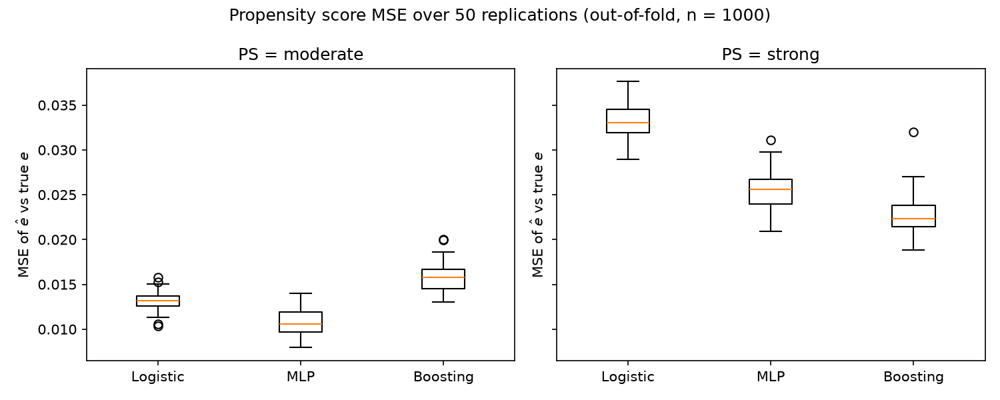

# Deep Learning for Propensity Score Estimation and ATE Estimation

STAT 8810 course project (Ohio State University) — Taoyi Chen and Zihan Zhang

A simulation study of whether flexible models (a neural network and gradient boosting) estimate propensity scores more accurately than logistic regression, and whether more accurate propensity scores lead to more accurate inverse probability weighting (IPW) estimates of the average treatment effect (ATE).

## Repository structure

```
01_generate_data.ipynb     simulate the data (known true propensity score and ATE)
02_fit_propensity.ipynb    Part 1: fit propensity score models with 5-fold cross-fitting
03_ate_ipw.ipynb           Part 2: IPW estimates of the ATE and evaluation
sim_data/                  simulated datasets, settings (meta.json), data checks and figures
results/                   estimated propensity scores, metrics (CSV) and figures
requirements.txt
```

## How to run

```bash
pip install -r requirements.txt
```

Run the notebooks in order from this folder: `01` → `02` → `03`. All random seeds are fixed, so the results are reproducible. Running `01` regenerates `sim_data/`; `02` takes a few minutes on a laptop CPU; `03` takes seconds.

## Simulation design

- **Covariates:** $X_1,\dots,X_{10}$, correlated (AR(1), $\rho = 0.3$); $X_3, X_6, X_9$ binary, the rest standard normal. $X_1$–$X_4$ are confounders, $X_5$–$X_7$ affect treatment only, $X_8$–$X_{10}$ affect the outcome only.
- **Propensity score** (two nonlinear scenarios, good overlap, $P(A=1) = 0.5$, $e(X) \in [0.01, 0.99]$):
  - *moderate*: linear terms plus squares and pairwise interactions (73% of the logit is linear in $X$);
  - *strong*: sine, threshold, absolute-value and three-way interaction terms (26% linear).
- **Outcome:** $Y(a) = \mu_0(X) + a\,\tau(X) + \varepsilon$, with nonlinear $\mu_0$ (including $x_1x_8$ and $x_2x_4$) and heterogeneous effect $\tau(X) = 1 + 0.5x_1 + 0.5x_2^2$. **True ATE = 1.5.**
- **Size:** $n = 1000$ per dataset, 50 replications per scenario.

## Methods

- **Propensity score models:** logistic regression (main effects, unpenalized); MLP (10 → 32 → 32 → 1, ReLU, dropout 0.2, Adam, weight decay $10^{-2}$, early stopping); gradient boosting (depth-2 trees, learning rate 0.05, early stopping). All use the binary cross-entropy loss. MLP and boosting hyperparameters were chosen on separate pilot datasets, not on the 50 analysis datasets.
- **5-fold cross-fitting:** every unit's $\hat e(X_i)$ comes from a model fit without that unit. The same out-of-fold $\hat e$ is used for Part 1 (MSE against the true $e$) and Part 2 (IPW).
- **ATE estimators:** Horvitz–Thompson IPW (primary) and normalized (Hájek) IPW; benchmarks are the naive difference in means and oracle IPW using the true $e(X)$.

## Results

### Part 1 — propensity score accuracy (mean out-of-fold MSE over 50 replications)

| Scenario | Logistic | MLP | Boosting |
|---|---|---|---|
| moderate | 0.0131 | **0.0108** | 0.0158 |
| strong | 0.0332 | 0.0255 | **0.0227** |

The MLP is the only model more accurate than logistic regression in both scenarios (46/50 and 50/50 replications). Boosting is the most accurate in the *strong* scenario but the least accurate in the *moderate* one.



### Part 2 — ATE estimation (Horvitz–Thompson IPW, true ATE = 1.5)

| Scenario | Method | Bias | SD | RMSE |
|---|---|---|---|---|
| moderate | Naive | +0.331 | 0.221 | 0.396 |
| moderate | Logistic | −0.008 | 0.116 | **0.116** |
| moderate | MLP | +0.009 | 0.126 | 0.125 |
| moderate | Boosting | +0.093 | 0.124 | 0.154 |
| moderate | Oracle (true $e$) | −0.026 | 0.278 | 0.276 |
| strong | Naive | +0.853 | 0.181 | 0.872 |
| strong | Logistic | +0.180 | 0.109 | 0.210 |
| strong | MLP | +0.117 | 0.132 | **0.176** |
| strong | Boosting | +0.231 | 0.114 | 0.257 |
| strong | Oracle (true $e$) | −0.031 | 0.243 | 0.242 |


### Main findings

1. **A more accurate propensity score does not guarantee a more accurate ATE.** In the *strong* scenario, boosting has the lowest propensity score MSE but the most biased ATE, while the MLP gives the most accurate ATE. Pooled over models, the rank correlation between propensity score MSE and absolute ATE error is about 0.05.
2. **What matters is balance on the terms that also drive the outcome.** The remaining imbalance in $x_2x_4$ (which enters both the propensity score and $\mu_0$) after weighting tracks the ATE bias: logistic 0.43, boosting 0.36, MLP 0.25, oracle 0.01 (strong scenario).
3. **The true propensity score is not the best weight.** Oracle IPW is nearly unbiased but about twice as variable as IPW with estimated scores, consistent with Hirano, Imbens & Ridder (2003).
4. Hájek and Horvitz–Thompson IPW give the same ranking of methods; no estimated or true propensity score fell outside $[0.01, 0.99]$, so trimming made no difference.


