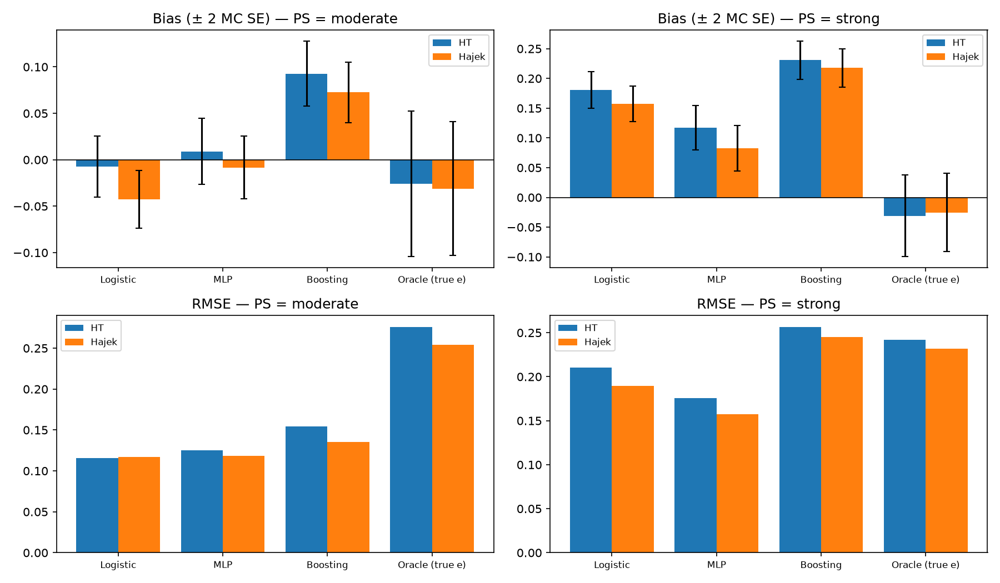
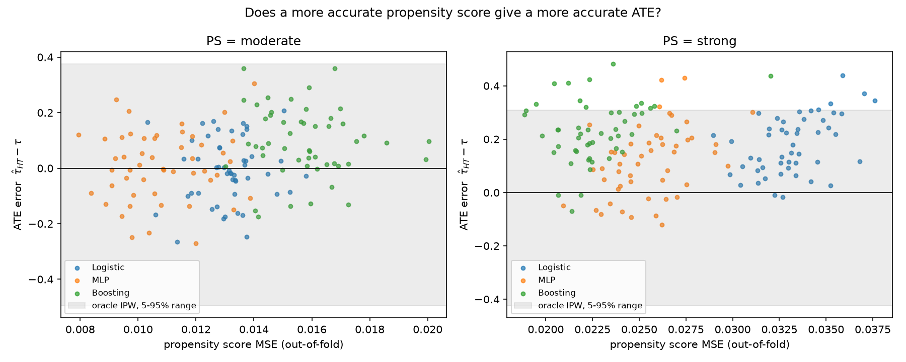
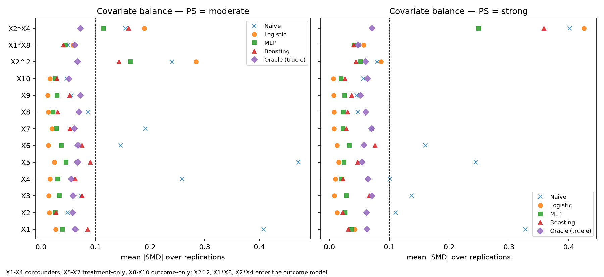
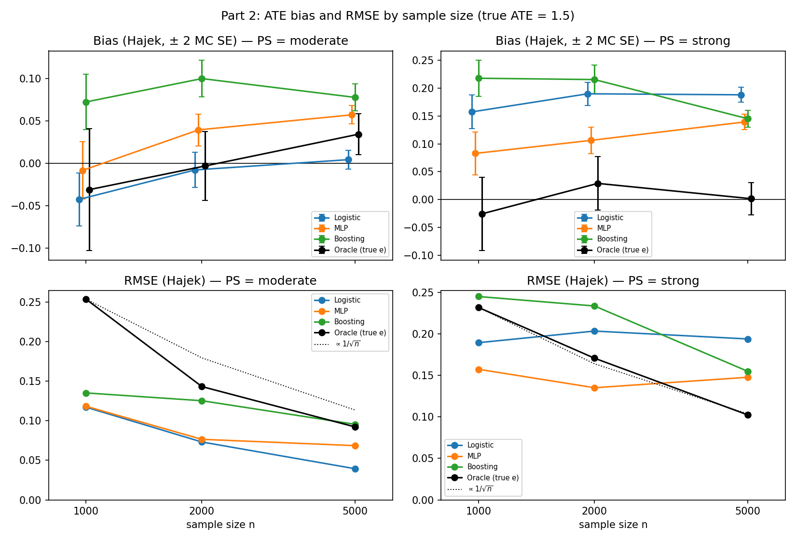

# Deep Learning for Propensity Score Estimation and ATE Estimation

STAT 8810 course project (Ohio State University) — Taoyi Chen and Zihan Zhang

A simulation study of whether flexible models (a neural network and gradient boosting) estimate propensity scores more accurately than logistic regression, and whether more accurate propensity scores lead to more accurate inverse probability weighting (IPW) estimates of the average treatment effect (ATE).

## Repository structure

```
01_generate_data.ipynb     simulate the data (known true propensity score and ATE)
02_fit_propensity.ipynb    Part 1: fit propensity score models with 5-fold cross-fitting
03_ate_ipw.ipynb           Part 2: IPW estimates of the ATE and evaluation
04_compare_n.ipynb         Part 3: how the results change with sample size
sim_data/                  simulated datasets (n = 1000, 2000, 5000), settings (meta.json), checks, figures
results/                   n = 1000 (main analysis): estimated propensity scores, metrics (CSV), figures
results_n2000/             same outputs for n = 2000
results_n5000/             same outputs for n = 5000
results_compare_n/         tables and figures comparing n = 1000, 2000, 5000
requirements.txt
```

## How to run

```bash
pip install -r requirements.txt
```

Run the notebooks in order from this folder: `01` → `02` → `03`. All random seeds are fixed, so the results are reproducible. Running `01` regenerates `sim_data/`; `02` takes a few minutes on a laptop CPU at $n = 1000$ (about 13 minutes at $n = 5000$); `03` takes seconds.

The sample size is set by `N` in the first code cell of `02` and `03` (default `N = 1000`, written to `results/`; `N = 2000` or `5000` writes to `results_n{N}/`). To reproduce Part 3, run `02` and `03` with each `N`, then run `04`.

## Simulation design

- **Covariates:** $X_1,\dots,X_{10}$, correlated (AR(1), $\rho = 0.3$); $X_3, X_6, X_9$ binary, the rest standard normal. $X_1$–$X_4$ are confounders, $X_5$–$X_7$ affect treatment only, $X_8$–$X_{10}$ affect the outcome only.
- **Propensity score** (two nonlinear scenarios, good overlap, $P(A=1) = 0.5$, $e(X) \in [0.01, 0.99]$):
  - *moderate*: linear terms plus squares and pairwise interactions (73% of the logit is linear in $X$);
  - *strong*: sine, threshold, absolute-value and three-way interaction terms (26% linear).
- **Outcome:** $Y(a) = \mu_0(X) + a\,\tau(X) + \varepsilon$, with nonlinear $\mu_0$ (including $x_1x_8$ and $x_2x_4$) and heterogeneous effect $\tau(X) = 1 + 0.5x_1 + 0.5x_2^2$. **True ATE = 1.5.**
- **Size:** $n = 1000$ per dataset (main analysis), 50 replications per scenario. Part 3 repeats everything at $n = 2000$ and $n = 5000$ (new, independent datasets; same seeds scheme, same hyperparameters).

## Methods

- **Propensity score models:** logistic regression (main effects, unpenalized); MLP (10 → 32 → 32 → 1, ReLU, dropout 0.2, Adam, weight decay $10^{-2}$, early stopping); gradient boosting (depth-2 trees, learning rate 0.05, early stopping). All use the binary cross-entropy loss. MLP and boosting hyperparameters were chosen on separate pilot datasets, not on the 50 analysis datasets.
- **5-fold cross-fitting:** every unit's $\hat e(X_i)$ comes from a model fit without that unit. The same out-of-fold $\hat e$ is used for Part 1 (MSE against the true $e$) and Part 2 (IPW).
- **ATE estimators:** Horvitz–Thompson IPW (primary) and normalized (Hájek) IPW; benchmarks are the naive difference in means and oracle IPW using the true $e(X)$.

## Results

### Part 1 — propensity score accuracy (mean out-of-fold MSE over 50 replications)

| Scenario | Logistic | MLP | Boosting |
|---|---|---|---|
| moderate | 0.0131 | **0.0108** | 0.0158 |
| strong | 0.0332 | 0.0255 | **0.0227** |

The MLP is the only model more accurate than logistic regression in both scenarios (46/50 and 50/50 replications). Boosting is the most accurate in the *strong* scenario but the least accurate in the *moderate* one.


### Part 2 — ATE estimation (Horvitz–Thompson IPW, true ATE = 1.5)

| Scenario | Method | Bias | SD | RMSE |
|---|---|---|---|---|
| moderate | Naive | +0.331 | 0.221 | 0.396 |
| moderate | Logistic | −0.008 | 0.116 | **0.116** |
| moderate | MLP | +0.009 | 0.126 | 0.125 |
| moderate | Boosting | +0.093 | 0.124 | 0.154 |
| moderate | Oracle (true $e$) | −0.026 | 0.278 | 0.276 |
| strong | Naive | +0.853 | 0.181 | 0.872 |
| strong | Logistic | +0.180 | 0.109 | 0.210 |
| strong | MLP | +0.117 | 0.132 | **0.176** |
| strong | Boosting | +0.231 | 0.114 | 0.257 |
| strong | Oracle (true $e$) | −0.031 | 0.243 | 0.242 |



### Main findings

1. **A more accurate propensity score does not guarantee a more accurate ATE.** In the *strong* scenario, boosting has the lowest propensity score MSE but the most biased ATE, while the MLP gives the most accurate ATE. Pooled over models, the rank correlation between propensity score MSE and absolute ATE error is about 0.05.
2. **What matters is balance on the terms that also drive the outcome.** The remaining imbalance in $x_2x_4$ (which enters both the propensity score and $\mu_0$) after weighting tracks the ATE bias: logistic 0.43, boosting 0.36, MLP 0.25, oracle 0.01 (strong scenario).
3. **The true propensity score is not the best weight.** Oracle IPW is nearly unbiased but about twice as variable as IPW with estimated scores, consistent with Hirano, Imbens & Ridder (2003).
4. Hájek and Horvitz–Thompson IPW give the same ranking of methods; no estimated or true propensity score fell outside $[0.01, 0.99]$, so trimming made no difference.





### Part 3 — how the results change with sample size

Everything was rerun at $n = 2000$ and $n = 5000$ with the **same hyperparameters** (chosen once at $n = 1000$ on pilot data, not re-tuned) and 50 new replications per setting. The question: is the ATE bias of the estimated propensity scores a finite-sample problem that disappears with more data?

**Propensity score MSE**

| Scenario | Model | $n=1000$ | $n=2000$ | $n=5000$ |
|---|---|---|---|---|
| moderate | Logistic | 0.0131 | 0.0114 | 0.0106 |
| moderate | MLP | 0.0108 | 0.0065 | **0.0048** |
| moderate | Boosting | 0.0158 | 0.0110 | 0.0067 |
| strong | Logistic | 0.0332 | 0.0313 | 0.0302 |
| strong | MLP | 0.0255 | 0.0199 | 0.0175 |
| strong | Boosting | 0.0227 | 0.0174 | **0.0105** |

**ATE bias and RMSE (Horvitz–Thompson IPW, true ATE = 1.5)**

| Scenario | Method | Bias $n=1000$ / $2000$ / $5000$ | RMSE $n=1000$ / $2000$ / $5000$ |
|---|---|---|---|
| moderate | Logistic | −0.008 / +0.008 / +0.012 | 0.116 / 0.072 / **0.041** |
| moderate | MLP | +0.009 / +0.027 / +0.030 | 0.125 / 0.071 / 0.048 |
| moderate | Boosting | +0.093 / +0.107 / +0.075 | 0.154 / 0.132 / 0.093 |
| moderate | Oracle | −0.026 / −0.015 / +0.034 | 0.276 / 0.169 / 0.097 |
| strong | Logistic | +0.180 / +0.202 / +0.194 | 0.210 / 0.215 / 0.200 |
| strong | MLP | +0.117 / +0.102 / +0.116 | 0.176 / 0.134 / **0.127** |
| strong | Boosting | +0.231 / +0.221 / +0.136 | 0.257 / 0.238 / 0.146 |
| strong | Oracle | −0.031 / +0.029 / −0.001 | 0.242 / 0.179 / 0.108 |

Monte Carlo SE of the bias for the estimated propensity scores (the oracle's is about twice as large): about 0.015–0.018 at $n = 1000$, 0.010–0.013 at $n = 2000$, 0.005–0.008 at $n = 5000$. Full tables (HT and Hájek, paired comparisons, balance) are in `results_compare_n/`.



**Findings**

1. **The bias of IPW with estimated propensity scores is systematic, not a small-sample effect.** Logistic regression's bias in the *strong* scenario stays at about 0.19 (misspecification). The MLP's bias does not shrink either: with HT it stays at about 0.11 in the *strong* scenario and grows from 0.01 to 0.03 in the *moderate* one; with Hájek it grows in both (*strong*: 0.08 → 0.11 → 0.14). As the SD falls with $n$, bias becomes most of the error. Only boosting's bias falls clearly (*strong*: 0.23 → 0.14).
2. **The clearest case of "more accurate propensity score, less accurate ATE".** In the *moderate* scenario at $n = 5000$, the MLP's propensity score MSE is less than half of logistic regression's (0.0048 vs 0.0106), yet its ATE RMSE is higher (HT 0.048 vs 0.041; Hájek 0.069 vs 0.039), and logistic regression is closer to the truth in 38 of 50 replications (Hájek).
3. **Likely mechanism: the regularized MLP shrinks propensity scores toward 0.5 at every $n$.** The slope of $\operatorname{logit}\hat e$ on $\operatorname{logit} e$ stays at about 0.73 (*moderate*) and 0.43 (*strong*) for the MLP at all three sample sizes, while boosting's rises with $n$ (0.62 → 0.79 and 0.44 → 0.67) as it uses more trees (median 94 → 293 in *strong*). Shrunken scores give weights that are too uniform (the MLP's largest weight falls with $n$, the true one rises), so part of the confounding is not removed and the estimate is pulled toward the naive one. A weight-decay penalty fixed at the $n = 1000$ value does not vanish as $n$ grows, which would explain a non-vanishing bias; this has not been tested yet.
4. **Oracle IPW behaves as theory predicts:** unbiased at every $n$, with RMSE falling like $1/\sqrt n$. At $n = 5000$ it beats every estimated propensity score in the *strong* scenario, because their error is now mostly bias.
